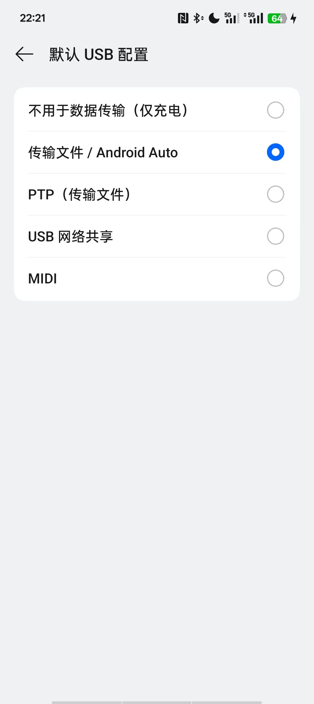
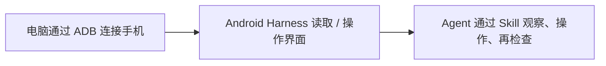

# Android Harness

让 Agent 直接操作 Android 真机的小工具。

Android Harness 通过 Android 自带的 ADB 和 UI Automator，让 Codex 这类 Agent 能读取手机当前页面、找按钮、点击、滑动、截图、打开应用，也可以直接用 PowerShell 手动控制。

如果你只是想尽快用起来，**不用先看懂 ADB，也不用从头读完整篇 README。** 最省事的方式就是把这个仓库交给 Agent，让它自己帮你装；你只在手机必须本人确认的时候配合一下就行。

## 最省事：直接让 Agent 帮你装

把这个仓库链接发给支持本地 Skill 的 Agent（例如 Codex），然后直接把下面这段话发给它：

```text
请把 https://github.com/HangHang04/android-harness 安装成一个本地 Skill。
先检查我电脑上需要的环境；能自动完成的下载、安装和配置请直接帮我处理。
如果需要我在手机上打开开发者选项、USB 调试、确认授权或进行无线配对，再一步一步告诉我怎么做。
安装好后先运行 doctor 检查连接，确认正常以后再用这个 Skill 操作我的手机。
```

通常这些事情都可以交给 Agent：

- 下载仓库；
- 检查 Python、ADB 等电脑端环境；
- 安装 Android Harness；
- 安装本地 Skill；
- 运行 `doctor` 检查哪里还没配置好；
- 根据检查结果继续带你排错。

你真正需要自己动手的，通常只是手机上的几步：

- 打开开发者选项和 USB / 无线调试；
- 确认电脑的 RSA 调试授权；
- 无线调试时查看并输入一次性配对码；
- 解锁手机，或确认涉及账号、支付、权限等敏感操作。

> Agent 不能替你点击 Android 的系统授权弹窗，也不会绕过锁屏或身份验证。这些步骤本来就应该由你本人确认。

安装 Skill 后，**新建一个 Codex 任务**，让 Skill 列表刷新。之后就可以直接说人话，例如：

```text
用 android-harness 看看我的手机有没有连接好。
```

```text
打开手机设置，告诉我现在这个页面有什么。
```

```text
帮我找到开发者选项里的无线调试，但先不要修改任何开关。
```

```text
帮我看看当前 App 为什么卡在这个页面，只观察和截图，不要改任何东西。
```

如果到这里已经能正常操作手机，**后面的内容可以先不用看。** 遇到连接或安装问题时，再回来找对应部分就行。

## 第一次使用：手机怎么连？

这是整个过程里最值得自己看一眼的部分，因为手机上的授权必须由你完成。

Android Harness 支持两种连接方式：

- **USB 数据线**：最直观，电脑能正常识别手机时优先推荐；
- **无线调试**：USB 一直识别不了时很好用，也不要求电脑本身连 Wi-Fi，Windows 可以把有线网络共享成热点。

不知道选哪个的话：**先试 USB；如果 `adb devices -l` 一直看不到手机，就直接换无线调试。**

### 方法 A：USB 数据线

#### 手机上先做这几步

1. 打开“设置 > 关于本机”；
2. 连续点击“版本号”约 7 次，直到提示已进入开发者模式；
3. 打开“开发者选项 > USB 调试”；
4. 保持手机解锁，重新插拔数据线；
5. 如果出现“是否允许 USB 调试”的 RSA 指纹弹窗，确认允许。

部分手机还有“USB 调试（安全设置）”之类的额外选项。普通读取、截图、点击能正常用时不用管它；只有某些操作确实被系统拦住时再检查。

#### 电脑上看看有没有识别到手机

如果 ADB 是 Android Studio 默认安装位置，可以在 PowerShell 里运行：

```powershell
$adb = "$env:LOCALAPPDATA\Android\Sdk\platform-tools\adb.exe"
& $adb devices -l
```

看到类似下面这样：

```text
XXXXXXXX    device
```

就说明手机已经连接并授权，可以继续用了。

常见结果可以直接看这张表：

| 看到的状态 | 是什么意思 | 怎么办 |
| --- | --- | --- |
| `device` | 已连接并授权 | 运行 `doctor` |
| `unauthorized` | 数据线是通的，但手机还没授权 | 解锁手机，确认 RSA 弹窗 |
| `offline` | ADB 看到了手机，但连接状态异常 | 重新插拔，或者重启 ADB |
| 什么设备都没有 | Windows 连 ADB 设备都没识别出来 | 换数据线 / USB 口，或者直接试无线调试 |

需要重启 ADB 时：

```powershell
& $adb kill-server
& $adb start-server
& $adb devices -l
```

#### 一个很容易误会的地方

<p align="center">
  
</p>

手机里的“默认 USB 配置 / 传输文件 / Android Auto”只是决定 USB 默认拿来干什么，**不代表 ADB 已经授权成功。**

所以如果一直没有 RSA 调试弹窗，不要只在这个页面来回切。最有用的判断还是看：

```powershell
& $adb devices -l
```

如果 Windows 设备管理器出现“设备描述符请求失败”或错误代码 43，说明问题通常还发生在 ADB 授权之前。可以按这个顺序试：

1. 换一条确认能传数据的数据线；
2. 直接插电脑 USB 口，不经过扩展坞；
3. 换另一个 USB 口；
4. 手机保持解锁后重新插拔；
5. 还是不行，就别继续和 USB 较劲了，直接用下面的无线方案。

### 方法 B：电脑热点 + 无线调试

如果 USB 怎么都识别不了，可以让 Windows 开一个热点，让手机通过无线 ADB 连接。

电脑只有网线也没关系，Windows 可以把以太网共享成 Wi-Fi 热点。

#### 先让手机和电脑在同一个局域网

1. Windows 打开“设置 > 网络和 Internet > 移动热点”；
2. 打开热点，把当前 Internet 连接共享出去；
3. 手机连接电脑刚创建的 Wi-Fi；
4. 手机打开“开发者选项 > 无线调试”；
5. 点“使用配对码配对设备”。

手机会显示 IP、配对端口和六位配对码。

**配对码只在你自己电脑的终端里输入。不要把它写进截图、Issue、日志或公开仓库。**

#### 如果手机显示的 IP 看起来很奇怪

有些手机会把 VPN、游戏加速器或其他虚拟网卡的 IP 显示在无线调试页面里。

例如手机显示 `172.x.x.x`，但 Windows 热点实际是 `192.168.x.x`，这时直接照抄手机上的 IP 就可能一直失败。

最省事的办法是把手机和电脑当前的网络信息交给 Agent，让它帮你判断。

想自己看也可以在 PowerShell 运行：

```powershell
Get-NetIPAddress -AddressFamily IPv4 |
    Where-Object InterfaceAlias -Match 'Local Area Connection|Wi-Fi Direct|移动热点' |
    Select-Object InterfaceAlias, IPAddress, PrefixLength

Get-NetNeighbor -AddressFamily IPv4 |
    Where-Object State -NotIn 'Unreachable', 'Incomplete' |
    Select-Object InterfaceAlias, IPAddress, State
```

手机真正的 Wi-Fi IP 应该和电脑热点网关处于同一个子网。Windows 热点经常是 `192.168.137.x`，但不要死记这个数字，以你自己电脑的实际结果为准。

#### 开始配对

```powershell
$phoneIp = 'PHONE_WIFI_IP'
$pairingPort = 'CURRENT_PAIRING_PORT'

Test-NetConnection -ComputerName $phoneIp -Port $pairingPort
& $adb pair "${phoneIp}:${pairingPort}"
```

看到：

```text
Enter pairing code:
```

再输入手机当前显示的六位配对码。

成功后会看到类似：

```text
Successfully paired to PHONE_WIFI_IP:PAIRING_PORT
```

然后检查设备：

```powershell
& $adb mdns services
& $adb devices -l
```

如果已经显示配对成功，但 `adb devices` 还是空的，可以先重启一次 ADB：

```powershell
& $adb kill-server
& $adb start-server
& $adb mdns services
& $adb devices -l
```

还不行的话，在手机“无线调试”主页面查看当前的**调试连接端口**，再执行：

```powershell
$debugPort = 'CURRENT_DEBUG_PORT'
& $adb connect "${phoneIp}:${debugPort}"
& $adb devices -l
```

这里有个很容易踩的坑：**配对端口和日常连接端口不是同一个端口。**

#### 无线调试常见问题

| 现象 | 常见原因 | 可以怎么处理 |
| --- | --- | --- |
| `protocol fault (couldn't read status message)` | IP 指到了 VPN / 虚拟网卡，或者端口已经过期 | 检查热点子网，重新打开配对弹窗 |
| 已显示 Successfully paired，但设备列表为空 | 把配对端口当成了连接端口，或 mDNS 没发现服务 | 运行 `adb mdns services`，必要时手动 `adb connect` |
| `Test-NetConnection` 失败 | 手机和电脑不在同一局域网，或端口已经变化 | 确认手机连着电脑热点，再生成一次配对信息 |
| 用一会儿就断 | 热点 / 无线调试关闭、省电策略或 ADB 重启 | 保持热点和无线调试开启，再检查设备列表 |

## 怎么知道已经配置好了？

不管你用 USB 还是无线，最后都可以跑一次：

```powershell
$env:PYTHONUTF8 = '1'
py -3 -m android_harness.cli --json doctor
```

主要看两件事：

- `adb devices -l` 里的设备状态是 `device`；
- `doctor` 顶层返回 `"ok": true`，必需检查都通过。

如果你是让 Agent 帮忙配置的，**直接让它运行 `doctor` 并解释哪里没通过就行，不需要自己研究那一坨 JSON。**

`unicode-companion` 没安装也没关系，它只影响中文、emoji 等 Unicode 文本输入，不影响截图、读取界面和普通点击。

## 想自己安装，而不是让 Agent 配置

目前项目主要面向：

- Windows 10 / 11；
- Python 3.11 或更高版本；
- Android SDK Platform Tools（里面有 `adb.exe`）；
- Android 11 / API 30 或更高版本的真机；
- 推荐 PowerShell 7（`pwsh.exe`）。

如果不确定环境齐不齐，也可以只让 Agent 帮你检查环境，再自己完成后面的命令。

在 PowerShell 中执行：

```powershell
git clone 'https://github.com/HangHang04/android-harness.git'
Set-Location -LiteralPath '.\android-harness'
py -3 -m pip install --user .
```

如果还要让 Codex 直接通过 Skill 使用它，再执行：

```powershell
py -3 -m android_harness.cli --json skill --install
```

安装完成后新建一个 Codex 任务，让 Skill 列表刷新。

如果 pip 提示 `Scripts` 目录不在 `PATH`，通常可以先忽略。这里的命令都可以通过 `py -3 -m android_harness.cli` 运行，不依赖那个目录。

如果只是开发或测试这个仓库，也可以不安装到用户目录，直接在仓库根目录运行：

```powershell
.\android-harness.ps1 --json doctor
```

## 不用 Agent，也可以自己敲命令

如果你想自己控制每一步，可以直接用 CLI：

```powershell
$env:PYTHONUTF8 = '1'

# 看屏幕信息
py -3 -m android_harness.cli --json screen-info

# 截图
py -3 -m android_harness.cli screenshot -o '.\phone-screen.png'

# 读取当前页面的文字、资源 ID 和坐标
py -3 -m android_harness.cli --json ui

# 点击唯一匹配的文字
py -3 -m android_harness.cli --json tap-text '设置'

# 滑动 / Home / 打开设置
py -3 -m android_harness.cli --json swipe up
py -3 -m android_harness.cli --json key home
py -3 -m android_harness.cli --json open-app com.android.settings
```

在仓库根目录也可以用短启动脚本：

```powershell
.\android-harness.ps1 --json ui
.\android-harness.ps1 --json tap-text '设置'
```

多个设备同时在线时，需要明确指定设备：

```powershell
py -3 -m android_harness.cli --serial 'DEVICE_SERIAL' --json doctor
```

ASCII 文本可以通过标准输入发送：

```powershell
'hello from Android Harness' |
    py -3 -m android_harness.cli --json type --stdin
```

ADB 原生输入对 Unicode 支持有限。中文、emoji 和其他 Unicode 文本需要可选 companion IME；Android Harness 不会为了“看起来成功”而偷偷把不能输入的字符丢掉。

## 它能做什么？

- 检查 ADB、授权状态、Android 版本、锁屏状态、截图和 UI 读取能力；
- 获取当前屏幕截图；
- 读取可访问的文字、内容描述、资源 ID、坐标和交互状态；
- 按文字或坐标点击；
- 长按、滑动、滚动、按系统按键、打开应用；
- 操作后重新观察页面，确认刚才的动作有没有真的生效；
- 运行显式的 Python 工作流；
- 可选支持中文、emoji 和其他 Unicode 输入。

使用 Skill 时，推荐让 Agent 按照**“先看清楚 → 再操作 → 操作后再确认”**的方式工作。

如果出现多个同名按钮，或者涉及发送消息、购买、删除、安装应用、修改权限、系统设置、身份验证等操作，应该先停下来确认，而不是盲点。

## 它做不到什么？

- 不能替你批准 RSA 授权、解锁手机或绕过身份验证；
- 多台设备同时在线时，不应该偷偷猜该操作哪一台；
- DRM / 安全页面可能是黑屏或没有可读 UI，这种情况不应该盲点；
- Canvas、游戏以及没有无障碍标签的图标，可能需要结合截图判断；
- 不支持多点触控、相机 / 生物识别确认、远程解锁和无人值守重连；
- 不应该把配对码、验证码、私人消息或带账户信息的截图写进日志或提交到公开仓库。

## 它大概是怎么工作的？

如果你只是使用，其实不需要懂这一段。

简单来说就是三层：



ADB 负责让电脑和 Android 手机通信；Android Harness 把常用的读取、点击、滑动、截图等能力整理成更适合 Agent 使用的接口；Skill 再告诉 Agent 应该怎么安全、可靠地调用这些能力。

所以真正的前提只有一个：**先让 ADB 稳定看到手机。** 一旦这一步通了，后面的很多操作就可以交给 Agent。

项目受到 [ShawnPana/phone-harness](https://github.com/ShawnPana/phone-harness) 启发，但 Android Harness 是独立的 Android / ADB 实现，不需要 root、scrcpy、Appium，也不需要在手机里常驻一个服务。

## 开发与测试

电脑端没有第三方运行时依赖。可以直接运行标准库测试：

```powershell
$env:PYTHONPATH = Join-Path (Get-Location) 'src'
py -3 -m unittest discover -s tests -v
py -3 -m compileall -q src tests
```

如果安装了可选开发依赖：

```powershell
py -3 -m pytest
py -3 -m ruff check .
```

可选 Unicode companion 位于 `companion\`，使用单独的 Gradle、JDK 17 和 Android SDK 工具链。

## 许可证

[MIT License](LICENSE)

## 致谢

Android Harness 的灵感来自 [ShawnPana/phone-harness](https://github.com/ShawnPana/phone-harness)，特别是它轻量、面向 Agent 的“观察、操作、验证”工作流。

本仓库是独立的 Android / ADB 实现，感谢 ShawnPana 公开分享原项目和设计思路。
