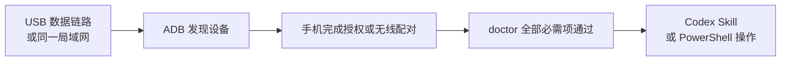

# Android Harness

Android Harness 是一个面向 Windows 的 Android 真机控制工具。它让 Codex 或 PowerShell 通过 ADB 读取当前屏幕、查找界面元素、点击、滑动、截图和打开应用。

项目受到 [ShawnPana/phone-harness](https://github.com/ShawnPana/phone-harness) 启发，但这里使用的是 Android 原生的 ADB、UI Automator 和输入能力，不依赖 root、scrcpy、Appium，也不需要在手机上常驻服务。

## 先看结论

这个项目最难的通常不是“点击手机”，而是先把电脑和手机稳定地连接起来。建议按下面的顺序排查：



连接成功的两个判断标准是：

```powershell
$adb = "$env:LOCALAPPDATA\Android\Sdk\platform-tools\adb.exe"
& $adb devices -l
py -3 -m android_harness.cli --json doctor
```

- `adb devices -l` 中设备状态为 `device`。
- `doctor` 返回顶层 `"ok": true`，所有 `required: true` 的检查都通过。
- `unicode-companion` 显示未安装不影响截图、读取和点击，它只是中文、emoji 等 Unicode 输入的可选组件。

## 环境要求

- Windows 10 或 Windows 11。
- PowerShell 7，推荐使用 `pwsh.exe`。
- Python 3.11 或更高版本。
- Android SDK Platform Tools，也就是包含 `adb.exe` 的工具包。
- Android 11 / API 30 或更高版本的真机。

## 安装电脑端

在 PowerShell 中执行：

```powershell
git clone 'https://github.com/HangHang04/android-harness.git'
Set-Location -LiteralPath '.\android-harness'
py -3 -m pip install --user .
```

如果 pip 提示 `Scripts` 目录不在 `PATH`，可以先忽略；本文统一使用 `py -3 -m android_harness.cli`，不依赖那个目录。

如果还要在 Codex 中直接用自然语言操作手机，再安装本项目自带的 Skill：

```powershell
py -3 -m android_harness.cli --json skill --install
```

安装后新建一个 Codex 任务，让 Skill 列表刷新。开发项目本身时，也可以不做用户级安装，直接在仓库根目录运行：

```powershell
.\android-harness.ps1 --json doctor
```

## 先把手机连接起来

项目支持两种连接方式：USB 数据线和无线调试。第一次使用建议先试 USB；如果 Windows 一直无法识别 USB 设备，可以改用“电脑热点 + 无线调试”。

### 连接方法 A：USB 数据线

#### 1. 打开开发者选项和 USB 调试

不同品牌入口略有不同，一般是：

1. 打开手机“设置 > 关于本机”。
2. 连续点击“版本号”约 7 次，直到提示已经进入开发者模式。
3. 返回“设置 > 开发者选项”。
4. 打开“USB 调试”。
5. 保持手机解锁，再重新插拔数据线。

部分厂商还提供“USB 调试（安全设置）”之类的额外开关。只有普通点击无法执行时才需要检查它，并由用户自己在手机上开启。

#### 2. 不要把“默认 USB 配置”误当成 ADB 授权

<p align="center">
  
</p>

上图选择“传输文件 / Android Auto”只是在指定 USB 的默认用途。它不能证明：

- Windows 已经正确枚举了手机；
- ADB 驱动已经工作；
- 手机已经弹出并通过了 RSA 调试授权。

所以没有授权弹窗时，不要只反复切换这个页面。

#### 3. 在电脑上检查 ADB

下面是 Android Studio 默认安装位置；如果你的 `adb.exe` 在其他地方，请替换路径：

```powershell
$adb = "$env:LOCALAPPDATA\Android\Sdk\platform-tools\adb.exe"
& $adb devices -l
```

根据结果处理：

| 输出状态 | 含义 | 下一步 |
| --- | --- | --- |
| `device` | 已连接并授权 | 运行 `doctor` |
| `unauthorized` | USB 数据链路正常，但手机尚未授权 | 解锁手机，确认 RSA 指纹弹窗 |
| `offline` | ADB 看到了设备，但会话异常 | 重新插拔，然后重启本机 ADB 服务 |
| 列表为空 | Windows 没有提供可用的 ADB 设备 | 换数据线、直连 USB 口并检查设备管理器 |

重启本机 ADB 服务：

```powershell
& $adb kill-server
& $adb start-server
& $adb devices -l
```

如果设备管理器显示“设备描述符请求失败”或错误代码 43，问题发生在 ADB 授权之前，通常是数据线、USB 接口、转接器或 Windows 枚举问题。优先尝试：

1. 使用确认能传数据的数据线；
2. 直接连接电脑 USB 口，不经过扩展坞；
3. 更换另一个 USB 口；
4. 保持手机解锁后重新插拔；
5. 仍失败时改用下面的无线方案。

### 连接方法 B：电脑热点 + 无线调试

电脑只有有线网络也可以使用这个方案：让 Windows 把以太网共享为 Wi-Fi 热点，再让手机连接这个热点。

#### 1. 建立同一局域网

1. Windows 打开“设置 > 网络和 Internet > 移动热点”。
2. 将“共享我的 Internet 连接”设为以太网。
3. 打开移动热点。
4. 手机连接电脑刚创建的 Wi-Fi。
5. 手机打开“开发者选项 > 无线调试 > 使用配对码配对设备”。

手机展示的六位配对码只在本机 PowerShell 提示中输入，不要把配对码写进命令、截图、Issue 或日志。

#### 2. 确认手机真正的 Wi-Fi IP

手机的无线调试页面有时会显示 VPN、游戏加速器或其他虚拟网卡的 IP。比如手机显示 `172.x.x.x`，但电脑热点实际使用 `192.168.x.x`，这时直接照抄手机显示的 IP 就可能出现协议错误。

先在电脑查看热点接口和邻居设备：

```powershell
Get-NetIPAddress -AddressFamily IPv4 |
    Where-Object InterfaceAlias -Match 'Local Area Connection|Wi-Fi Direct|移动热点' |
    Select-Object InterfaceAlias, IPAddress, PrefixLength

Get-NetNeighbor -AddressFamily IPv4 |
    Where-Object State -NotIn 'Unreachable', 'Incomplete' |
    Select-Object InterfaceAlias, IPAddress, State
```

判断原则：

- 手机的真实 Wi-Fi IP 应该和电脑热点网关处于同一子网；
- Windows 热点常见网段是 `192.168.137.x`，但必须以你电脑实际输出为准；
- 如果同一热点连接了多个设备，不要猜测，先断开其他设备或逐一确认；
- 只替换 IP，配对端口仍使用手机当前配对弹窗显示的端口。

#### 3. 测试端口并配对

每次重新打开配对弹窗，都使用页面当前显示的新端口和新配对码：

```powershell
$phoneIp = 'PHONE_WIFI_IP'
$pairingPort = 'CURRENT_PAIRING_PORT'

Test-NetConnection -ComputerName $phoneIp -Port $pairingPort
& $adb pair "${phoneIp}:${pairingPort}"
```

看到 `Enter pairing code:` 后，在 PowerShell 中输入手机当前显示的六位配对码。成功时会看到类似：

```text
Successfully paired to PHONE_WIFI_IP:PAIRING_PORT
```

#### 4. 配对成功后确认连接

配对端口和日常调试连接端口不是同一个端口。配对成功后，优先让 ADB 通过 mDNS 自动发现连接端口：

```powershell
& $adb mdns services
& $adb devices -l
```

如果已经显示 `Successfully paired`，但设备列表仍为空：

```powershell
& $adb kill-server
& $adb start-server
& $adb mdns services
& $adb devices -l
```

仍然无法自动发现时，可以在手机“无线调试”主页面查看当前调试端口，再连接那个端口，而不是刚才的配对端口：

```powershell
$debugPort = 'CURRENT_DEBUG_PORT'
& $adb connect "${phoneIp}:${debugPort}"
& $adb devices -l
```

#### 无线连接常见报错

| 现象 | 常见原因 | 处理方式 |
| --- | --- | --- |
| `protocol fault (couldn't read status message)` | IP 指向 VPN/虚拟接口、端口已过期，或并非配对端口 | 核对热点子网，重新打开配对弹窗并使用新端口、新配对码 |
| 已成功配对，但 `adb devices` 为空 | 配对端口与连接端口混淆，或 mDNS 没有发现服务 | 运行 `adb mdns services`，必要时使用主页面的调试端口执行 `adb connect` |
| `Test-NetConnection` 失败 | 手机和电脑不在同一局域网，或端口已经变化 | 确认手机连接电脑热点，再重新生成配对信息 |
| 一会儿能用、一会儿断开 | 热点关闭、手机切回移动网络、省电策略或 ADB 服务重启 | 保持热点和无线调试开启，再检查 `adb devices -l` |

## 连接后的统一验收

无论使用 USB 还是无线连接，最后都运行：

```powershell
$env:PYTHONUTF8 = '1'
py -3 -m android_harness.cli --json doctor
```

`PYTHONUTF8` 可以避免 Windows 在输出中文或 emoji 界面文字时出现编码错误。

## 两种操作方式

### 操作方式一：使用 Codex Skill（推荐新手）

安装 Skill 后，新建一个 Codex 任务，直接描述想做的事情：

```text
用 $android-harness 检查我的手机是否连接正常。
```

```text
用 $android-harness 打开手机设置，截一张图并告诉我当前页面有什么。
```

```text
用 $android-harness 向上滚动开发者选项，找到无线调试，但不要修改任何开关。
```

Skill 会按照“观察 → 操作 → 再验证”的顺序工作：

1. 先运行只读 `doctor`；
2. 优先读取 UI 元素，必要时再截图；
3. 执行点击或滑动后重新检查页面；
4. 遇到多个同名按钮时停止并确认目标；
5. 发送消息、购买、删除、安装应用、修改权限或设置前必须再次征得用户同意。

这种方式适合不知道 ADB 命令、希望直接描述目标的用户。

### 操作方式二：使用 PowerShell 命令

如果想自己控制每一步，可以直接调用 Python 模块。全局参数 `--json`、`--serial` 和 `--adb` 必须写在子命令前面。

```powershell
$env:PYTHONUTF8 = '1'

# 查看设备信息
py -3 -m android_harness.cli --json screen-info

# 截图到指定文件
py -3 -m android_harness.cli screenshot -o '.\phone-screen.png'

# 读取当前页面的文字、资源 ID 和坐标
py -3 -m android_harness.cli --json ui

# 点击唯一匹配的可见文字
py -3 -m android_harness.cli --json tap-text '设置'

# 向上滑动、返回主页、打开设置
py -3 -m android_harness.cli --json swipe up
py -3 -m android_harness.cli --json key home
py -3 -m android_harness.cli --json open-app com.android.settings
```

也可以在仓库根目录使用短启动脚本：

```powershell
.\android-harness.ps1 --json ui
.\android-harness.ps1 --json tap-text '设置'
```

多个设备同时在线时，必须明确指定一个序列号：

```powershell
py -3 -m android_harness.cli --serial 'DEVICE_SERIAL' --json doctor
```

ASCII 文本从标准输入读取，避免直接进入 shell 历史：

```powershell
'hello from Android Harness' |
    py -3 -m android_harness.cli --json type --stdin
```

ADB 原生输入只支持有限 ASCII 字符。中文、emoji 和其他 Unicode 文本需要可选 companion IME；项目不会静默丢字或自动转写。

## 能做什么

- 检查 ADB、设备授权、Android 版本、锁屏状态、截图和 UI 读取能力；
- 获取当前屏幕 PNG；
- 读取可访问的文字、内容描述、资源 ID、边界和交互状态；
- 按文字或屏幕坐标点击；
- 长按、滑动、滚动、按系统按键和打开应用；
- 等待页面稳定，并判断一次滚动是否真的移动；
- 运行显式的 Python 工作流；
- 可选支持中文、emoji 和其他 Unicode 输入。

## 安全边界与限制

- 工具不会替用户批准 RSA 授权、解锁手机或绕过身份验证；
- 多设备在线时不会静默选择设备；
- DRM 和安全页面可能返回黑色截图或没有 UI 节点，此时不会盲点；
- Canvas、游戏和没有无障碍标签的图标可能需要结合截图判断；
- 不支持多点触控、相机或生物识别确认、远程解锁和无人值守重连；
- 默认不写活动日志，截图只应保留完成任务所必需的内容；
- 不要把配对码、验证码、私人消息或带账户信息的截图提交到公开仓库。

## 开发与测试

电脑端没有第三方运行时依赖。无需安装开发工具也可以运行标准库测试：

```powershell
$env:PYTHONPATH = Join-Path (Get-Location) 'src'
py -3 -m unittest discover -s tests -v
py -3 -m compileall -q src tests
```

如果安装了可选开发依赖：

```powershell
py -3 -m pytest
py -3 -m ruff check .
```

可选 Unicode companion 位于 `companion\`，使用单独的 Gradle、JDK 17 和 Android SDK 工具链。

## 许可证

[MIT License](LICENSE)

## 致谢

Android Harness 的灵感来自 [ShawnPana/phone-harness](https://github.com/ShawnPana/phone-harness)，特别是它轻量、面向 Agent 的“观察、操作、验证”工作流,感谢 ShawnPana 公开分享原项目和设计思路。
